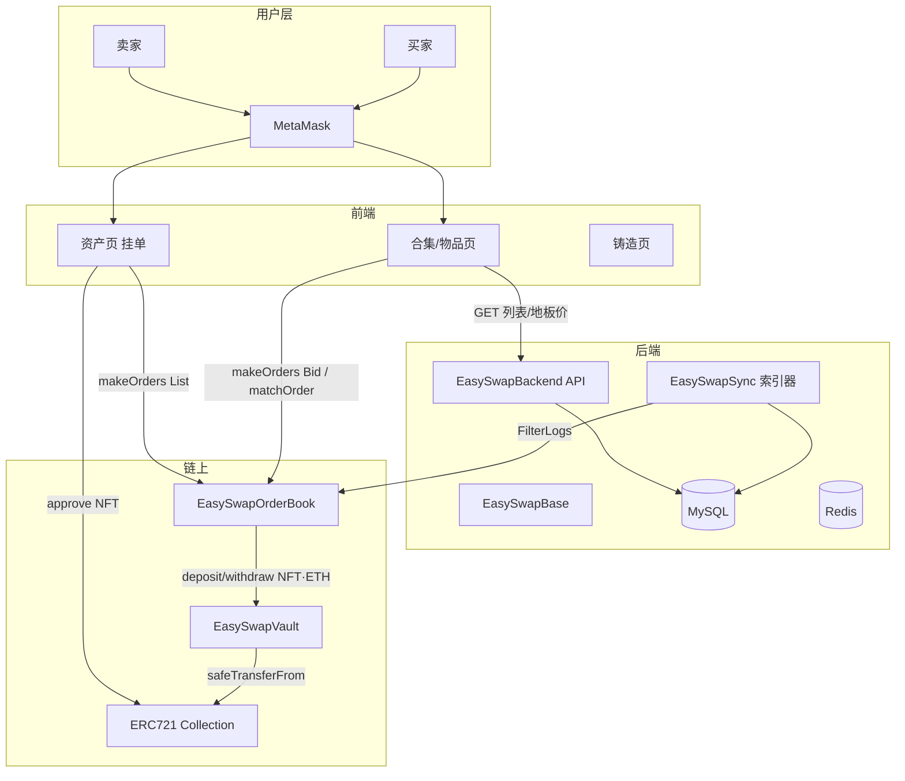
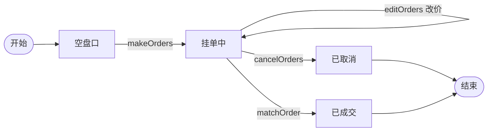
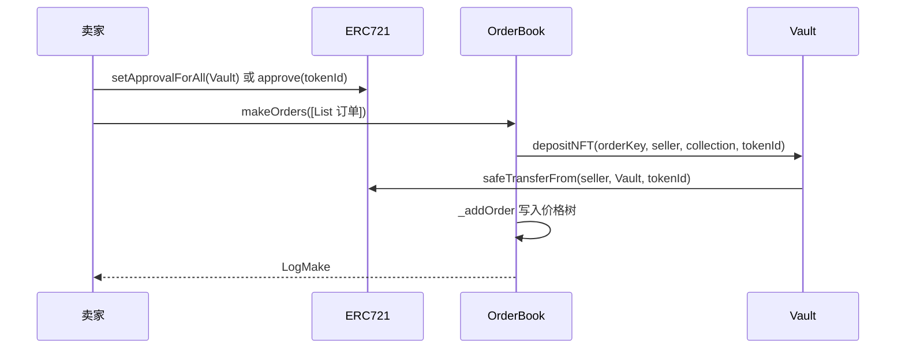
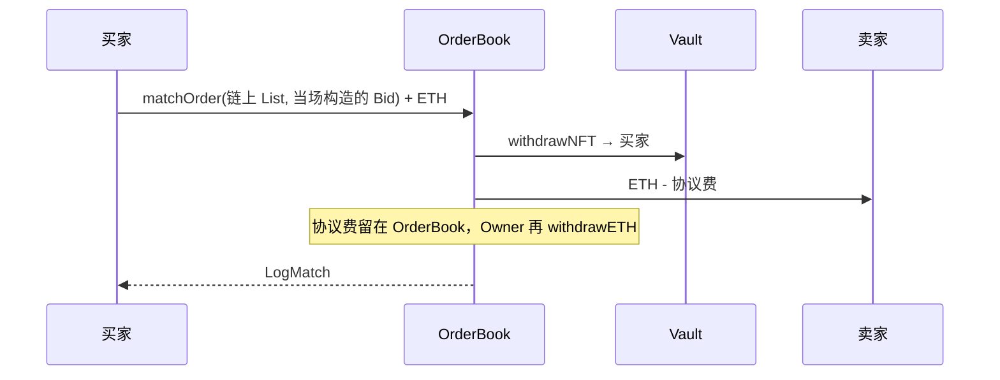
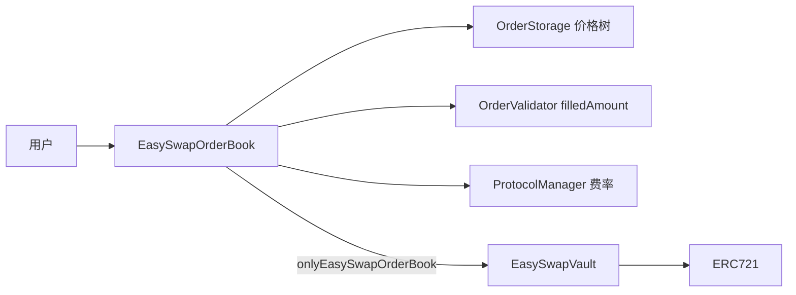

# NFTMarket（EasySwap）项目拆解文档

> 学习目标：从**业务**理解项目，而不是背代码。读完应能独立画出架构图、讲清挂单/出价/成交、说明合约与同步服务职责。  
> 代码依据：`EasySwapContract`、`EasySwapSync`、`EasySwapBackend`、`EasySwapBase`、`nft-market-fe`。  
> 仓库：https://github.com/MetaNodeAcademy/ProjectBreakdown-NFTMarket

---

## 0. 一句话讲清这个项目

EasySwap 是一个 **链上订单簿（OrderBook DEX）形态的 NFT 市场**。

卖家把 NFT 锁进金库并挂单价；买家把 ETH 锁进金库并出价；任意一方都可以来「吃单」。成交时合约同时完成 NFT 过户、ETH 结算和协议抽成。链下服务不托管资产，只把 `LogMake` / `LogCancel` / `LogMatch` 扫进数据库，给前端做列表、地板价和活动流。

它和 OpenSea（Seaport）的差别要先讲清：OpenSea 订单主要在**链下签名**，上架几乎不花 gas，成交才上链；EasySwap 订单写在**链上**，上架就要 gas，同时资产被托管，盘口可以按价格树直接查。

---

## 1. 项目解决什么问题

| 对比维度 | OpenSea / Seaport | EasySwap |
| --- | --- | --- |
| 订单存放 | 链下签名，中继器广播 | 合约存储 + 红黑树盘口 |
| 上架成本 | 低（通常只需授权） | 高（`makeOrders` 上链 + 锁资产） |
| 资产托管 | 成交瞬间从卖家钱包转出 | 挂单时 NFT/ETH 进入 Vault |
| 撮合 | Taker 提交签名订单 | Taker 调 `matchOrder`，合约校验盘口 |
| 价格发现 | 链下聚合 | 链上 `getBestPrice` / `getBestOrder` |
| 取消 | 链上 cancel 或过期 | `cancelOrders` 退回托管资产 |

**业务上的三个关键选择：**

1. **订单在链上。** 盘口可验证、可查询，不必信任中继器；代价是挂单就要付 gas、锁资产。
2. **金库与订单簿分离。** `EasySwapVault` 只认 OrderBook 地址，资产进出有单一入口。
3. **成交必须有人主动 match。** 合约不会自动把最优买卖价对敲。前端或用户构造 `sellOrder + buyOrder` 再调用。

---

## 2. 仓库怎么拆

```
ProjectBreakdown-NFTMarket/
├── EasySwapContract/     # 智能合约（Hardhat + Solidity 0.8.19）
├── EasySwapSync/         # 事件索引：扫 LogMake / LogCancel / LogMatch
├── EasySwapBackend/      # HTTP API：Collection / Item / Order / Activity
├── EasySwapBase/         # 共享库：DB 模型、链客户端、订单管理器
└── nft-market-fe/        # Next.js 前端（钱包写链 + 调 API 读列表）
```

读代码时记住：**NFT 和 ETH 以合约为准；Sync 是事件索引；Backend 是只读查询；前端是操作入口。**

---

## 3. 整体架构图



**分工一句话：**

- **OrderBook**：挂单、改价、取消、撮合。
- **Vault**：按 `OrderKey` 托管 NFT 和 ETH。
- **Sync**：按区块扫事件入库，维护断点 `last_indexed_block`。
- **Backend**：给前端提供合集、物品、出价、活动、投资组合。
- **前端**：展示走 REST；上架/出价/购买走钱包。

---

## 4. 角色、订单与资产

### 4.1 角色（卖家 Maker、买家 Maker、Taker、协议 Owner）

同一用户可以既是 Maker 又是 Taker：挂单后等人来买，也可以自己去吃别人的出价。挂单、取消、改价都不把 NFT 过户给买家。只有 `matchOrder` 才同时完成过户、付款和抽成。两条资金流的细节在 4.3。

**卖家 Maker（List）**

锁 NFT，挂固定单价：`approve(Vault)` → `makeOrders(List)`。

| 动作 | 注解 |
| --- | --- |
| `approve(Vault)` | 授权给金库，不是 OrderBook。之后 `depositNFT` 才能把这一件从卖家钱包转进 Vault |
| `makeOrders(List)` | 挂卖单。`amount` 必须是 1。成功后 NFT 进 Vault，订单写入价格树，返回这张单的 OrderKey |

**买家 Maker（Bid）**

锁 ETH，对单品或整集合出价：`makeOrders(Bid)` + `msg.value`。

| 动作 | 注解 |
| --- | --- |
| `makeOrders(Bid)` | 按 `单价 × amount` 把 ETH 锁进 Vault。多付的退回。可以是某一件，也可以是整集合出价 |

**Taker**

吃对方已存在的单：`matchOrder(sell, buy)`。调用者必须是卖单或买单的 maker。

| 动作 | 注解 |
| --- | --- |
| `matchOrder`（买家来调） | 成交价用卖价。没事先挂 Bid 就是 Buy Now，钱从 `msg.value` 出 |
| `matchOrder`（卖家来调） | 成交价用买价。ETH 已经在 Vault，`msg.value` 必须是 0 |

**协议 Owner**

改费率、暂停、提取协议费。

| 动作 | 注解 |
| --- | --- |
| `setProtocolShare` | 改费率。`250 / 10000 = 2.5%`，上限 10%。已经挂着的单下次成交按新费率算 |
| `pause` | `make` / `cancel` / `edit` / `match` 都不能再调。已经锁在 Vault 里的资产要等 `unpause` |
| `withdrawETH` | 把成交时留在 OrderBook 里的协议费转走。用户的 NFT 和出价 ETH 在 Vault，不在这里 |

### 4.2 订单结构（`LibOrder.Order`）

| 字段 | 含义 |
| --- | --- |
| `side` | `List=0` 卖 / `Bid=1` 买 |
| `saleKind` | `FixedPriceForCollection=0` 集合出价 / `FixedPriceForItem=1` 单品 |
| `maker` | 必须等于 `msg.sender` |
| `nft.collection / tokenId / amount` | NFT；List 的 amount 必须为 1 |
| `price` | **单价**（uint128） |
| `expiry` | unix 秒；`0` 表示永不过期 |
| `salt` | 防哈希碰撞，不能为 0 |

`OrderKey = hash(Order)`，整单内容变一点，key 就变。所以改价不是改字段，而是 **取消旧单 + 建新单**。

### 4.3 两种成交路径

**路径 A：买家吃挂单（最常见「Buy Now」）**

1. 卖家已 `makeOrders(List)`，NFT 在 Vault。
2. 买家构造一个匹配的 Bid（可以不先上链），调 `matchOrder`。
3. 买家当场付 ETH（`msg.value >= 挂单价`），NFT 从 Vault 转给买家。

| 动作 | 注解 |
| --- | --- |
| `makeOrders(List)` | 卖单 `amount` 必须是 1。`depositNFT` 把这一件转进 Vault，`NFTBalance[orderKey] = tokenId`，再 `_addOrder` 写入价格树 |
| `matchOrder` | 调用者是买单 maker。卖单必须已经在盘口。成交价 = 卖价。Bid 没进盘口就是 Buy Now：`msg.value >= 卖价`，不必事先 `makeOrders(Bid)`。NFT 用 `withdrawNFT` 从 Vault 给买家。卖家收到 `卖价 - 协议费` |

**路径 B：卖家吃出价**

1. 买家已 `makeOrders(Bid)`，ETH 在 Vault。
2. 卖家构造或使用已有 List，调 `matchOrder`。
3. 从 Vault 扣买家 ETH 给卖家（扣协议费），NFT 从 Vault 或卖家钱包转给买家。

| 动作 | 注解 |
| --- | --- |
| `makeOrders(Bid)` | 按 `单价 × amount` 调用 `depositETH`，ETH 记在这张 Bid 的 OrderKey 上。多付的由 `makeOrders` 退回。集合出价 `FixedPriceForCollection` 只出现在这里：买「这个合约下任意一件」，成交时 tokenId 以卖单为准 |
| `matchOrder` | 调用者是卖单 maker。`msg.value` 必须是 0，否则 `"HD: value > 0"`。成交价 = 买价。ETH 用 `withdrawETH` 从 Bid 那一格抽到 OrderBook，再付给卖家。卖单已在盘口：`withdrawNFT`；卖单不在盘口：`transferERC721` 从卖家钱包直接转给买家，卖家仍要先 `approve` 给 Vault |

两条路径的协议费都是 `成交价 × protocolShare / 10000`，留在 OrderBook，Owner 以后 `withdrawETH` 提走。路径 A 的成交价是卖价：S 挂 1 ETH，B 直接买，S 得 0.975 ETH。路径 B 的成交价是买价：B 出价 1.2 ETH，S 接受，S 得 1.17 ETH。

---

## 5. 核心业务流程



链上订单状态靠两张表：

- `orders[orderKey]`：还在盘口里（红黑树 + 同价链表）
- `filledAmount[orderKey]`：`0` 未成交；累加部分成交；`type(uint256).max` 已取消

---

## 6. 完整用户旅程


### 6.1 卖家挂单



### 6.2 买家立即购买（Taker 构造 Bid，不必事先 make）



### 6.3 买家先出价，卖家后接受

买家 `makeOrders(Bid)` 把 ETH 锁进 Vault；卖家 `matchOrder` 时 `msg.value` 必须为 0，钱从 Vault 出。

---

## 7. 合约层

### 7.1 合约如何协作



`EasySwapOrderBook` 多重继承：`OrderStorage` + `ProtocolManager` + `OrderValidator`，再单独指向 Vault。

| 合约 | 职责 |
| --- | --- |
| `EasySwapOrderBook.sol` | 对外入口：make / cancel / edit / match / multicall |
| `EasySwapVault.sol` | 按 OrderKey 托管 ETH、NFT |
| `OrderStorage.sol` | collection × side 的红黑树 + 同价 FIFO 队列 |
| `OrderValidator.sol` | 参数校验、filledAmount、取消标记 |
| `ProtocolManager.sol` | `protocolShare`，上限 1000/10000 = 10% |
| `LibOrder.sol` | 订单结构与哈希 |
| `LibPayInfo.sol` | `TOTAL_SHARE=10000`，`MAX_PROTOCOL_SHARE=1000` |
| `RedBlackTreeLibrary.sol` | 价格排序：Bid 取最高，List 取最低 |

### 7.2 用户操作 → 合约方法

| 业务 | 方法 | 谁能调 | 注解 |
| --- | --- | --- | --- |
| 批量挂单/出价 | `makeOrders` | maker = msg.sender | 一次可挂多张。字段不合格的那张返回 `0x0`，其它单留下。NFT 没授权，或 ETH 不够，整笔回滚 |
| 批量取消 | `cancelOrders` | 仅 maker | 卖单退 NFT。买单只退 `单价 × 未成交件数`。成功后 `filledAmount` 写成最大值，这把 key 不能再成交 |
| 改价改数量 | `editOrders` | 仅 maker | 先取消旧单再挂新单，OrderKey 一定变。卖单的 NFT 不离开 Vault。买单可改高（补差额进金库）也可改低（多的 ETH 退回） |
| 成交 | `matchOrder` | 卖单或买单的 maker | 成交价取被吃那一边。协议费留在 OrderBook，当时不打给 Owner |
| 批量成交 | `matchOrders` | 同上 | `delegatecall` 逐对撮合。某一对失败只记 `BatchMatchInnerError`，后面的继续。多付的 ETH 最后退一次 |
| 聚合操作 | `multicall` | 用户 | 一笔交易里串联 make / cancel / edit / match。会花钱的子调用最多一个，否则同一笔 `msg.value` 会被看到两次 |
| 查最优价 | `getBestPrice` / `getBestOrder` | 任意 | List 取最低卖价，Bid 取最高买价。同价先返回队列 `head`。只读，不改资产 |
| 分页盘口 | `getOrders` | 任意 | 从某一档接着翻。跳过过期单；查集合 Bid 时滤掉单品 Bid |

### 7.3 盘口数据结构（读 OrderStorage 的钥匙）

每个 collection、每个方向一棵价格树：

```
priceTrees[collection][List]  → first()，最左边，最低卖价
priceTrees[collection][Bid]   → last()，最右边，最高买价

orderQueues[collection][side][price] → 链表 head/tail
orders[orderKey] → { order, next }
```

同价按时间先进先出：新单接到 tail。  
`getBestOrder` 从最优价往下走，跳过过期单和 tokenId 不匹配的单品 Bid。

这就是「链上订单簿」四个字的实现：不是 mapping 随便存，而是按价格可遍历。

### 7.4 资金如何流转

**挂 List：** NFT 卖家 → Vault，记 `NFTBalance[orderKey] = tokenId`  
**挂 Bid：** ETH 买家 → Vault，记 `ETHBalance[orderKey] += 金额`（金额 = 单价 × amount）

**买家吃 List：**

```
买家 msg.value ≥ fillPrice（挂单价）
Vault.withdrawNFT → 买家
卖家收到 fillPrice - protocolFee
多余 ETH 退买家
协议费留在 OrderBook
```

**卖家吃 Bid：**

```
买家 ETH 从 Vault 提到 OrderBook
卖家收到 fillPrice - protocolFee（fillPrice 用 Bid 价）
NFT：若卖单已在盘口则 Vault.withdrawNFT；否则 transferERC721 直接从卖家钱包转
```

协议费计算：

```
fee = fillPrice × protocolShare / 10000
```

例如 share = 250 → 2.5%。Owner 调 `withdrawETH` 提走积在 OrderBook 里的手续费。

### 7.5 撮合校验 `_isMatchAvailable`

必须同时满足：

- 不是同一笔 orderKey
- sell 是 List，buy 是 Bid
- sell 的 saleKind 是 **FixedPriceForItem**（卖的一定是具体 token）
- 买卖双方 maker 不同
- 资产匹配：集合出价，或 collection+tokenId 都相同
- 双方都未完全成交

注意：合约**不检查**「买价必须 ≥ 卖价」在 `_isMatchAvailable` 里。买家吃单时才 `require(buyPrice >= fillPrice)` 或 `msg.value >= fillPrice`。卖家吃出价时成交价直接用 **Bid 价**。

### 7.6 和 Seaport 对照时值得讲的点

- 资产先托管，挂单不可再拿到别的市场去卖（除非先 cancel）。
- `makeOrders` 里，字段不合格的单返回 `0x0` 并允许部分成功。NFT 没授权、ETH 不够会整笔回滚，不是跳过。
- `matchOrders` 用 delegatecall，单笔失败不拖垮整批，靠 `BatchMatchInnerError` 暴露原因。
- List 限制 `amount == 1`，当前就是 ERC721 市场，不是 1155 通用市场。

---

## 8. 链下：只做列表

合约是资产和订单的账本。链下不托管 NFT，也不替用户发成交交易。

Sync 从 OrderBook 扫 `LogMake` / `LogCancel` / `LogMatch`，写入数据库，并记住扫到哪一块。Pledge 的后端是轮询合约上的 view；这里订单事件少、要精确到每一笔，所以扫日志。Backend 只读这些表，给页面提供合集、物品、出价和活动。列表会比链上晚几个区块。地板价是库里算出来的，不是页面每次去调 `getBestPrice`。

前端两件事：列表走 Backend；授权、挂单、出价、购买走钱包，直接调合约。授权对象是 Vault。

用户点「立即购买」时，钱和 NFT 的路径在第 6、7 节。后端不参与这笔转账。

---

## 9. 从业务角度怎么读代码

合约按学习笔记的课时读。拆解文档看到这里，函数级细节以笔记为准。

1. `LibOrder.sol`：订单字段和 OrderKey。
2. `EasySwapVault.sol`：挂单时资产进哪张表。
3. `OrderStorage.sol`：三个卖价怎么进树、同价谁在 `head`。
4. `EasySwapOrderBook.sol`：`makeOrders` → 取消 / 改价 → `_isMatchAvailable` → `_matchOrder` 两个分支 → `matchOrders` / `multicall`。

---

## 10. 讲解提纲

**1. 这是什么**  
链上 NFT 订单簿。挂单锁资产，Taker 来撮合，协议从成交额抽成。

**2. 和 OpenSea 的差别**  
订单上链、资产预托管、盘口可链上查询；不是链下签名成交时才上链。

**3. 钱和 NFT 怎么走**  
List：NFT 进 Vault。Bid：ETH 进 Vault。match：NFT 给买家，ETH 扣费后给卖家，费留在 OrderBook。

**4. 合约怎么分工**  
OrderBook 管盘口和撮合；Vault 管托管；价格树决定最优单。

**5. 后端干什么**  
Sync 扫 `LogMake/Cancel/Match` 入库；API 给前端列表。不管钱。

**6. 风险点**  
- 挂单锁定资产，卖家不能同时在别的市场卖  
- match 不自动对敲，依赖前端构造对手单  
- 协议费积在 OrderBook，靠 Owner 提取  
- 索引有确认延迟，前端列表不是即时链上状态  

---

## 11. 拆解自检

1. 挂单时 NFT 授权给 OrderBook 还是 Vault？

   授权给 Vault。 卖家 `approve` 或 `setApprovalForAll` 的对象是金库，不是 OrderBook。挂单成功后，这一件 NFT 也在 Vault 里

2. 改价为什么必须换 OrderKey？

   因为OrderKey =  hash(Order)

3. 买家 Buy Now 一定要先 `makeOrders` 吗？

   不用。 Buy Now 不必先 `makeOrders`。卖单已经在盘口上，买家当场用 `msg.value` 付款。只有事先挂过 Bid，成交时才从 Vault 抽 ETH。

4. 卖家接受 Bid 时为什么 `msg.value` 必须为 0？

   调用者是卖单 maker。`msg.value` 必须是 0，否则 `"HD: value > 0"`

5. 集合出价成交时 tokenId 以哪一侧为准？

   成交时 tokenId 以卖单为准

6. `filledAmount == type(uint256).max` 表示什么？

   `type(uint256).max` 已取消

7. Sync 和 Pledge 的 schedule 同步方式差在哪？

   Sync 扫事件日志，Pledge 的 schedule 轮询合约上的 view。 NFT 这边扫的是 `LogMake`、`LogCancel`、`LogMatch`，并记住扫到哪一块

   
