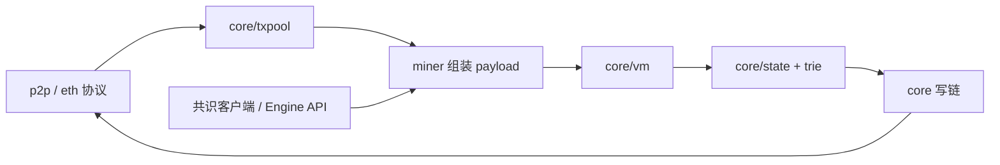
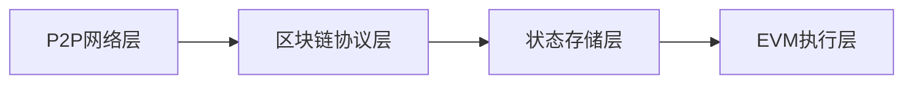
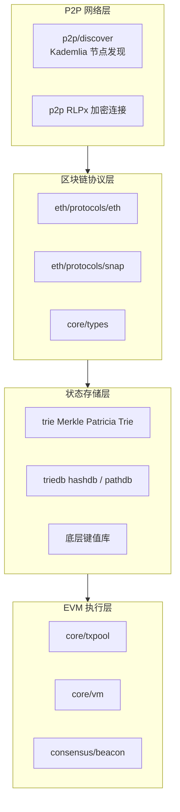

# Go-Ethereum 核心功能与架构设计

对照 go-ethereum v1.17.10 的源码结构，说明 Geth 在以太坊中的位置、各层如何衔接，以及作业里给出的 `eth/62`、Ethash 和 `miner.start()` 在当前代码中对应什么。本文只做源码分析，没有编译或启动节点。

### 1. Geth 的定位

Geth 是以太坊执行层的参考实现。它负责保存区块和状态、校验并执行交易、通过 devp2p 与其他执行客户端交换数据，并对外提供 JSON-RPC。

**what is devp2p?**

##### ***devp2p** 是以太坊节点之间互相找人、建立加密连接、再交换区块和交易的那套点对点协议。名字里的 dev 来自早期以太坊开发组，不是* `geth --dev` *那个开发网络。*

​	*它分成三步：*		

###### ***发现节点。*** `discv4` *和* `discv5` *用类似 Kademlia 的方式，根据节点 ID 的距离查找当前在线的对端。*`discv5` *还会带一份 ENR，写明这个节点支持哪些网络和协议。*

###### ***建立加密连接。** 找到对方的 IP 和端口后，用 RLPx 做握手。双方交换临时密钥，后面的 TCP 数据都是加密的。*

###### ***协商具体协议。** 连接建成后，双方说出自己会什么，例如* `eth/72` *和* `snap/1`*。对得上的协议才开始传区块头、交易和状态。*

*devp2p 本身不关心一笔交易是否合法。它只负责把节点连起来，并把字节流交给* `eth`*、*`snap` *这些上层协议*。

合并之后，选出规范链的工作不在 Geth 里。共识客户端（如 Lighthouse、Prysm）运行权益证明，通过 Engine API 把新的 payload 和分叉选择交给 Geth。Geth 执行这些区块，返回执行结果；最终确认由信标链完成。因此 Geth 是执行客户端，不是一条链上的“唯一节点软件”。

```
一台主网节点通常要同时跑两个客户端：

- 执行客户端，例如 Geth。它保存账户状态、执行交易、算出新的状态根。
- 共识客户端，例如 Lighthouse（Rust）或 Prysm（Go）。它运行权益证明，决定下一个区块由谁提议、哪些投票有效、哪段链已经最终确认。
```

设计上的分界是：P2P 和存储尽量与具体硬分叉解耦，区块校验、交易池和 EVM 则读取 `params` 里的分叉时间，决定启用哪些规则。

#### 2. 核心模块怎么配合

一笔交易从进入节点到写成状态，大致经过下面这条路径。




共识客户端通过 `eth/catalyst` 调用 `engine_forkchoiceUpdated` 和 `engine_getPayload`。`miner` 从交易池取出交易，EVM 按顺序执行，状态写入 Merkle Patricia Trie，最后把区块头、区块体和收据交给 `eth` 协议广播。

#### 2.1交易池与 Gas

`core/txpool` 把不同交易分成子池：`legacypool` 放普通交易，`blobpool` 放带 blob 的 EIP-4844 交易。交易进入池之前要能付得起自己的费用：nonce 连续、余额不少于 `value + gas × 费用上限`、gas 不低于固有 gas，EIP-1559 交易还要求 `maxFeePerGas` 不低于当前 base fee。

Gas 是执行预算，不是转账金额。EVM 按操作码扣 gas，耗尽就回滚状态，但已消耗的 gas 仍然要付。EIP-1559 之后，费用分成两部分：

- **base fee** 由父区块利用率算出，被销毁，不付给出块者。
- **priority fee**（tip）付给出块者。实际单价不超过 `maxFeePerGas`。

池内按价格和 nonce 排序。出块时 `miner` 在 gas 上限和 blob 数量上限内挑选交易。本地账户的交易可以由 `core/txpool/locals` 记到日志里，节点重启后重新注入。

#### 2.2 EVM 执行环境

`core/vm` 是解释器。执行一笔交易时，调用方准备好四样东西：

- **区块上下文**：区块号、时间戳、coinbase、gas limit、base fee、blob base fee。
- **状态**：`core/state` 打开该区块的 state root，账户余额、nonce、代码和合约存储都落在 Trie 上。
- **规则**：`params` 按区块时间判断伦敦、上海、坎昆等分叉是否生效，决定有哪些操作码和预编译。
- **调用帧**：`CALL`、`DELEGATECALL`、`CREATE` 各自有调用栈、内存和剩余 gas。

执行成功则提交状态并写收据；回滚则丢弃这一笔的状态改动，gas 消耗保留在收据里。区块里的交易按顺序执行，后一笔看得到前一笔提交后的状态。

#### 2.3 共识：Ethash 与权益证明

`consensus/ethash` 仍留在源码里，用来校验合并前区块的难度和 PoW 封印。Ethash 把区块头和 DAG 做哈希，寻找低于难度目标的 nonce。合并后新区块不再做这个计算。

合并后的执行层规则在 `consensus/beacon`。它要求区块难度为 0、nonce 为 0，并检查时间戳和 gas limit 等执行层字段。真正的提议者选举、投票和最终确认在共识客户端。两边的接口是 `eth/catalyst`：共识客户端提交 payload，Geth 执行并回答 `VALID` 或 `INVALID`。

开发网络没有外部共识客户端。`geth --dev` 使用 `eth/catalyst/simulated_beacon.go` 里的模拟信标，在本机按周期产出区块。这和主网上的 Ethash 挖矿不是同一条路径。

## 3. 分层架构

作业要求的四层顺序是：

```text
[P2P网络层] -> [区块链协议层] -> [状态存储层] -> [EVM执行层]
```




| 层      | 做什么                              | 源码位置                                                  |
| ------ | -------------------------------- | ----------------------------------------------------- |
| P2P网络层 | 发现对端节点，建立加密连接                    | `p2p/discover`、`p2p`                                  |
| 区块链协议层 | 交换区块头、区块体、交易和收据                  | `eth/protocols/eth`、`eth/protocols/snap`、`core/types` |
| 状态存储层  | 用 Merkle Patricia Trie 保存账户和合约存储 | `trie`、`triedb`                                       |
| EVM执行层 | 校验交易、执行字节码、更新状态                  | `core/txpool`、`core/vm`、`consensus/beacon`            |


每一层只把结果交给下一层。P2P 层收到的字节流先被协议层解码成区块和交易，状态层按这些输入读出账户，EVM 执行后再把新的状态根写回状态层。

各层内部的模块如下：




数据从左到右进入节点，执行结果再沿协议层广播出去。下面三个模块是作业点名的部分，其中 `les` 需要按当前源码单独说明。

### 3.1 les：轻节点协议

`les`（Light Ethereum Subprotocol）曾经让轻客户端只下区块头，再按需要向全节点要收据和 Merkle 证明，自己不保存完整状态。v1.17.10 的源码树里已经没有 `les` 包。全节点同步改走 `snap`：按账户范围和存储槽批量拉取状态，再在本地生成 Trie。作业里的轻节点概念仍然有用，但它不是这份源码里的现行模块。

### 3.2 trie：Merkle Patricia Trie

以太坊状态根是一棵十六叉 Merkle Patricia Trie。`trie/node.go` 里的节点类型是：

- `fullNode`：16 个半字节分支，外加一个位置存放本节点的值。
- `shortNode`：压缩后的路径。路径在半字节边界结束且带值时是叶子，否则是扩展节点。
- `hashNode`：子节点未展开时只保留 32 字节哈希。
- `valueNode`：叶子上的 RLP 值。

节点先做 RLP，再做 Keccak-256，得到的哈希写入父节点。账户存在状态 Trie；合约存储另外有一棵 storage Trie，其根放在账户里。改一个叶子只会改从叶子到根的路径，所以区块头里的 32 字节 `stateRoot` 就能承诺整棵状态。

节点缓存和落盘在 `triedb`。`hashdb` 按哈希存节点，`pathdb` 按路径存，并保留一层层 diff，方便回滚。源码里还有 `trie/bintrie`，那是二进制 Trie 的实现，主网状态承诺目前仍是 Keccak MPT。

### 3.3 core/types：区块数据结构

`core/types` 定义执行层在网络和数据库之间传递的对象。


| 类型            | 作用                                          |
| ------------- | ------------------------------------------- |
| `Header`      | 父哈希、状态根、交易根、收据根、时间戳、gas、base fee、难度、nonce 等 |
| `Block`       | 区块头加上交易列表。区块哈希是区块头 RLP 的 Keccak             |
| `Transaction` | 传统交易、访问列表交易、EIP-1559 动态费用交易、blob 交易等        |
| `Receipt`     | 执行是否成功、累计 gas、日志、合约地址                       |


交易用发送方私钥签名，链 ID 写进签名，避免同一笔原始交易在另一条链上重放。区块体和区块头分开发送，所以 `eth` 协议可以先同步区块头，再按哈希补区块体。

### 3.4 P2P 层的 Kademlia

节点发现在 `p2p/discover`，注释写明它是 Kademlia 风格的协议。每个节点有 256 位 ID，两节点的距离是 ID 的按位异或。路由表按距离分成桶，查找时向更接近目标的节点递归询问。发现协议有 discv4 和 discv5，后者用 ENR 携带支持的协议和网络信息。

找到对端以后，RLPx 握手建立加密连接，再协商双方都会的能力，例如 `eth/72` 和 `snap/1`。发现协议只负责“找到谁”，链上的区块和交易由 `eth` 协议传输。

## 4. 核心组件的实现原理


| **组件**   | **实现原理**                                             |                                |
| -------- | ---------------------------------------------------- | ------------------------------ |
| P2P 网络层  | `p2p/discover`、RLPx                                  | 用 Kademlia 找到节点，再把连接加密         |
| 区块链协议层   | `eth/protocols/eth`、`snap`                           | 区块头、区块体、交易、收据怎么互相传输            |
| 状态存储层    | `trie`、`triedb`                                      | 账户和合约存储怎么收成一个状态根               |
| EVM 执行层  | `core/vm`、`core/state`                               | 交易字节码怎么执行，状态怎么改                |
| 交易池与 Gas | `core/txpool`                                        | 交易按什么规则排队，费用怎么算                |
| 区块数据结构   | `core/types`                                         | 区块头、交易、收据怎么编码和哈希               |
| 共识       | `consensus/ethash`、`consensus/beacon`、`eth/catalyst` | 旧区块怎么校验工作量证明；新区块怎么接收共识客户端送来的结果 |


