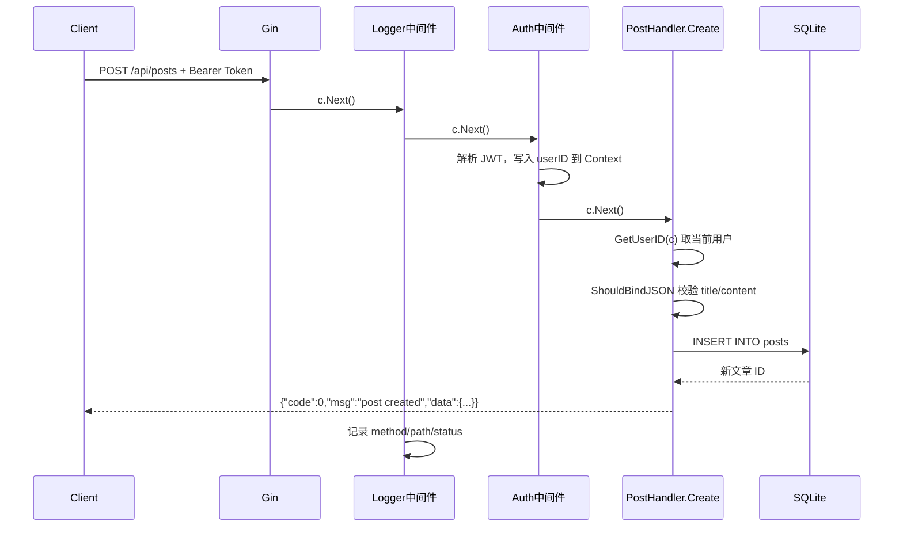

# 整体实现思路 — 个人博客 API (Gin + GORM + SQLite)

本文档说明**如何从零手写**这个项目，按步骤逐步实现即可。

API 接口、环境配置、curl 测试用例见 [README.md](./README.md)。

---

## 架构分层

自下而上构建，每一层只依赖下层，避免一次写太多文件。

```
HTTP 请求
    ↓
main.go（路由注册）
    ↓
middleware（日志 / 错误处理 / JWT 认证）
    ↓
handlers（业务逻辑：参数校验 → 查库/写库 → 返回 JSON）
    ↓
config.DB（GORM 全局连接）
    ↓
models（User / Post / Comment 表结构）
    ↓
SQLite 数据库文件
```

### 各包职责

| 包 | 职责 |
| --- | --- |
| `config` | 读 `.env`、连接 SQLite、AutoMigrate 建表 |
| `models` | 定义三张表的结构体和 GORM 标签 |
| `utils` | 工具函数：统一响应、bcrypt 密码、JWT 签发/解析 |
| `middleware` | 横切关注点：认证、日志、全局错误捕获 |
| `handlers` | 每个 HTTP 接口的具体业务逻辑 |
| `main` | 组装一切：初始化 → 挂中间件 → 注册路由 → 启动服务 |

---

## 请求处理流程（以「登录后创建文章」为例）



---

## 推荐手写顺序（共 8 步）

### 第 1 步：初始化项目

```bash
mkdir blog-api && cd blog-api
go mod init blog-api
go get github.com/gin-gonic/gin gorm.io/gorm gorm.io/driver/sqlite \
         github.com/joho/godotenv golang.org/x/crypto/bcrypt \
         github.com/golang-jwt/jwt/v5
```

### 第 2 步：定义数据模型（`models/models.go`）

- 先写 `User`、`Post`、`Comment` 三个 struct
- 关键 GORM 标签：`primaryKey`、`uniqueIndex`、`foreignKey`、`json:"-"`（隐藏密码）
- `Post.User` 和 `Comment.User` 是关联字段，方便 `Preload("User")` 加载作者

### 第 3 步：配置与数据库（`config/config.go`）

- `Load()`：用 `godotenv.Load()` 读 `.env`，`getEnv()` 带默认值
- `InitDB()`：`MkdirAll` 创建目录 → `gorm.Open(sqlite)` → `AutoMigrate` 三张表 → 赋值 `DB`
- 写 `.env.example` 和 `.env`

### 第 4 步：工具函数（`utils/`）

按依赖从简到繁：

1. `response.go`：`Success` / `Fail` / `AbortFail` — 统一 `{code, msg, data}` 格式
2. `password.go`：`HashPassword` + `CheckPassword` — bcrypt 加密与比对
3. `jwt.go`：`Claims` 结构体 + `GenerateToken` + `ParseToken` — HS256，7 天过期

### 第 5 步：中间件（`middleware/`）

1. `Logger()`：`c.Next()` 后记录 method/path/status
2. `ErrorHandler()`：`c.Next()` 后检查 `c.Errors`，未写响应则返回 500
3. `Auth(secret)`：解析 `Authorization: Bearer <token>` → `ParseToken` → `c.Set("userID", ...)`
4. `GetUserID(c)`：从 Context 安全读取 userID

### 第 6 步：认证 Handler（`handlers/auth.go`）

| 函数 | 路由 | 流程 |
| --- | --- | --- |
| `Register` | `POST /api/register` | 校验 JSON → `HashPassword` → `DB.Create` → 重复用户名/邮箱返回 409 |
| `Login` | `POST /api/login` | 查用户 → `CheckPassword` → `GenerateToken` → 返回 token |
| `Me` | `GET /api/me` | 从 Context 取 userID → 查库返回用户信息 |

### 第 7 步：文章 & 评论 Handler

**文章**（`handlers/post.go`）：

| 函数 | 路由 | 认证 |
| --- | --- | --- |
| `List` | `GET /api/posts` | 公开 |
| `Get` | `GET /api/posts/:id` | 公开 |
| `Create` | `POST /api/posts` | 需 JWT |
| `Update` | `PUT /api/posts/:id` | 需 JWT + 仅作者 |
| `Delete` | `DELETE /api/posts/:id` | 需 JWT + 仅作者 |

**评论**（`handlers/comment.go`）：

| 函数 | 路由 | 认证 |
| --- | --- | --- |
| `ListByPost` | `GET /api/posts/:id/comments` | 公开 |
| `Create` | `POST /api/posts/:id/comments` | 需 JWT |

共用辅助函数 `parseUintParam` 解析 URL 中的 `:id`。

删除文章时用 GORM `Transaction` 先删评论再删文章。

### 第 8 步：入口与路由（`main.go`）

```go
// 伪代码结构
cfg := config.Load()
config.InitDB(cfg.DBPath)

r := gin.New()
r.Use(gin.Recovery(), middleware.Logger(), middleware.ErrorHandler())

api := r.Group("/api")
api.POST("/register", ...)   // 公开
api.POST("/login", ...)      // 公开
api.GET("/posts", ...)       // 公开

authed := api.Group("/")
authed.Use(middleware.Auth(cfg.JWTSecret))
authed.POST("/posts", ...)   // 需 Token
authed.GET("/me", ...)       // 需 Token

r.Run(":" + cfg.Port)
```

---

## 核心设计要点

1. **路由分组**：公开接口和需认证接口分开注册；认证路由组统一挂 `Auth` 中间件，避免每个 handler 重复验 Token。
2. **Context 传用户身份**：中间件解析 JWT 后将 `userID` 写入 Gin Context，handler 通过 `GetUserID(c)` 获取，解耦认证与业务。
3. **作者权限**：Update/Delete 时比较 `post.UserID != 当前 userID`，返回 403，不做「管理员可删他人文章」的复杂逻辑。
4. **密码安全**：数据库只存 bcrypt 哈希；登录接口对「用户不存在」和「密码错误」返回相同 401 消息，防止枚举用户名。
5. **统一响应**：所有接口走 `utils.Success` / `utils.Fail`，前端只需判断 `code === 0`。
6. **级联删除**：SQLite 无复杂外键约束时，Delete 文章用 GORM Transaction 手动删关联评论。

---

## 函数速查表

阅读或重写源码时，可对照各函数功能：

### `config/config.go`

| 函数 | 功能 |
| --- | --- |
| `Load()` | 读取 `.env`，返回端口、JWT 密钥、数据库路径 |
| `InitDB()` | 连接 SQLite，自动建表，赋值全局 `DB` |
| `getEnv()` | 读环境变量，为空则返回默认值 |

### `utils/`

| 函数 | 功能 |
| --- | --- |
| `Success` / `SuccessMsg` | 返回 `{code:0, msg, data}`，HTTP 200 |
| `Fail` / `AbortFail` | 返回错误 JSON；`AbortFail` 还会中断后续 handler |
| `HashPassword` | 注册时用 bcrypt 加密密码 |
| `CheckPassword` | 登录时比对明文与哈希 |
| `GenerateToken` | 签发 JWT（HS256，7 天有效） |
| `ParseToken` | 验证并解析 JWT 载荷 |

### `middleware/`

| 函数 | 功能 |
| --- | --- |
| `Auth` | JWT 中间件，验证 Bearer Token，将 userID 写入 Context |
| `GetUserID` | 从 Context 读取当前登录用户 ID |
| `Logger` | 请求完成后记录 method/path/status |
| `ErrorHandler` | 捕获未处理错误，返回 500 |

### `handlers/`

| 函数 | 功能 |
| --- | --- |
| `Register` | 注册用户，密码 bcrypt 哈希后入库 |
| `Login` | 验证账号密码，返回 JWT |
| `Me` | 返回当前登录用户信息 |
| `List` / `Get` | 查询文章列表/详情（Preload 作者） |
| `Create` / `Update` / `Delete` | 文章增删改，修改操作校验作者身份 |
| `ListByPost` / `Create` | 查询/发表某篇文章下的评论 |

---

## 自测检查清单

手写完成后，按顺序验证：

- [ ] `go run main.go` 启动无报错，日志出现 `database connected`
- [ ] POST `/api/register` 注册成功，重复注册返回 409
- [ ] POST `/api/login` 返回 `token` 字段
- [ ] 不带 Token POST `/api/posts` 返回 401
- [ ] 带 Token 创建文章，GET `/api/posts` 能查到
- [ ] 用他人 Token PUT 他人文章返回 403
- [ ] POST 评论、GET 评论列表正常
- [ ] DELETE 文章后评论一并消失

---

## 建议学习流程

1. 先通读本文档，建立整体概念。
2. 实现第 1–4 步（models、config、utils），写个最简 `main.go` 只测数据库连接。
3. 加上中间件和 auth handler，用 curl 测注册/登录。
4. 实现 post、comment handler，测 CRUD 和权限错误。
5. 对照参考实现逐文件比对，重点理解**流程**，不要逐行抄代码。
