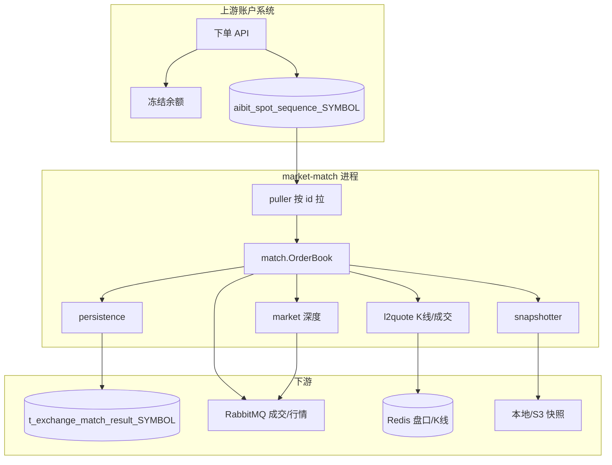
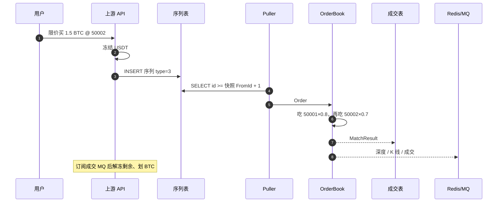

# market-match 撮合引擎项目拆解文档

> 学习目标：从**业务**理解项目。读完应能讲清订单从哪来、怎么进簿、怎么成交、成交价取谁、结果写到哪，以及它和永续 / NFTMarket 的差别。  
> 代码依据：`match/`（撮合核心）、`puller/`（拉单）、`market/` + `l2quote/`（行情）、`persistence/` + `snapshotter/`（落库与恢复）。  
> 注意：这个仓库**没有智能合约**。用户说的「撮合合约」对应的是这里的 **撮合引擎**——中心化交易所那一层「讨价还价」的程序。

---

## 0. 一句话讲清这个项目

market-match 是一个 **现货撮合引擎**：每个交易对一份内存订单簿，按价格优先、时间优先把买卖单配成成交。两边价格碰上了就按规则成交，不需要双方再商量。产出的是成交结果、盘口深度和 K 线。

订单不在链上。上游把已校验的委托写成 MySQL 序列表，引擎按 `id` 顺序拉取、撮合，再把 `MatchResult` 写回库、推 RabbitMQ、刷 Redis 行情。重启时用订单簿快照接着干。

它不是 NFT 市场（订单不写合约），也不是 MetaNode 永续（这里不结算保证金、不算资金费）。永续仓库里的 Relayer 也有一层撮合，但成交后还要调 `Perpetual.trade`；本仓库到成交记录为止。

---

## 术语说明

下面这些名称在这套撮合里有固定用法，不能只按字面理解。

| 名称 | 字面 | 在这套撮合里 |
| --- | --- | --- |
| 簿 / 订单簿 | 账本 | 还没成交、正在排队的那些单，加上它们的先后。是数据，不是撮合程序。一个交易对一份，放在进程内存里：买单在 `BuySet`，卖单在 `SellSet`，`cache` 用 `OrderId` 索引。进程一停这批数据就没了，靠快照写回磁盘 |
| `BuySet` / `SellSet` | 买集合 / 卖集合 | 两棵排序树。买单价高的在前，卖单价低的在前；同价 `SeqId` 小的在前。`Peek` 看到的是这棵树的第一张 |
| `cache` | 缓存 | `OrderId → 订单`。撤单直接查这张表。排序不看它 |
| `SeqId` | 序列号 | 这一张交易对的序列表 `aibit_spot_sequence_{交易对}` 的主键 `id`。Puller 扫进来。同价时小的先成交。新单必须比簿上的对手单大。BTC 和 ETH 各有自己的表，编号不互通 |
| `OrderId` | 订单号 | 同一行的 `order_id`。撤单、`cache` 用它，不参与排序 |
| `FromId` | 从哪条接着 | 这本簿已经处理到的最后一条 `SeqId`。快照把它一起存下来。重启后 Puller 从 `FromId + 1` 拉，不会把已经在簿里的单再读一遍 |
| `Maker` | 做市、挂单的人 | 已经排在簿上、被人吃到的那张。这一笔成交价取它的 `Price` |
| `Taker` | 吃单的人 | 新进来的这一张。它决定什么时候来吃。限价结果行上的 `price` 是它自己的限价，读成交价要看 Maker 行 |
| `Peek` | 偷看 | 取某一侧树的第一张，不把它拿下来。`Peek(Sell)` 是当前最低卖价里最早的那张 |
| `Enqueue` / `Dequeue` | 入队 / 出队 | 挂进簿 / 从簿拿掉。限价没吃完会 `Enqueue` 进自己那一侧。市价没吃完不入簿，结果记成撤掉 |
| `UnfilledAmount` | 未成交数量 | 限价、市价卖是币的个数。市价买是还剩多少报价货币，BTC/USDT 里就是 USDT |
| `Stp` | 自成交策略 | 默认 0（`AST`）。同一用户的买单吃自己的卖单，会按普通单成交。写成 1–4 才改走撤单或减量 |
| `FOK` | 全部成交否则取消 | 先把对手树上价配得上的量加一遍。不够就整张记成 `canceled`，簿上一张不动 |
| `MatchResult` | 撮合结果 | 这一张新单撮完后的记录。`items` 里先是若干 Maker 行，最后一条是 Taker 行。`price` 字段是最后一笔 Maker 价，在 `items` 外面 |
| 快照 | 照相 | 把当时的簿（还挂着的单和 `FromId`）用 gob 写到磁盘。gob 是 Go 自己的二进制序列化，把订单簿结构原样存下来。重启先装回这本簿，再从 `FromId + 1` 接着拉 MySQL |
| Puller | 拉取器 | 从 MySQL 序列表按 `id` 从小到大读订单。订单不从 RabbitMQ 来；RabbitMQ 只把成交结果和行情发出去 |

---

## 1. 项目解决什么问题

把「菜市场讨价还价」做成可恢复、可并发多交易对的程序，必须同时解决：

| 问题 | 本仓库的做法 |
| --- | --- |
| 买卖双方怎么配对 | 每个 symbol 一个 `OrderBook`：买单从高到低、卖单从低到高 |
| 同价谁先成交 | `SeqId` 小的在前（时间优先） |
| 订单从哪来、不能丢、不能乱序 | MySQL `aibit_spot_sequence_{symbol}`，按 id 递增拉 |
| 进程挂了怎么办 | gob 快照订单簿；启动时 Load，再从 `FromId+1` 续拉 |
| 前端要看盘口 / K 线 | `market` 聚合成交档，`l2quote` 写 Redis + MQ |
| 成交记录要对账 | `t_exchange_match_result_{symbol}` + 启动时回放校验 |

和 Pledge / NFTMarket / 永续对照：

| | Pledge | NFTMarket | MetaNode 永续 | **market-match** |
| --- | --- | --- | --- | --- |
| 链上核心 | 资金池状态机 | 订单簿 + Vault | Perpetual + Dealer | **无** |
| 订单在哪 | 无订单 | 链上价格树 | 链下签名 | **MySQL 序列 + 内存簿** |
| 后端角色 | 轮询 view | 扫事件 | Relayer 发 `trade()` | **引擎自己就是撮合** |
| 成交价 | — | 订单价 | Maker | **Maker（对手单价格）** |
| 钱谁管 | PledgePool | Vault | Dealer USDC | **本仓库不管钱**（上游已扣冻结） |

读代码时记住：**引擎只改订单簿和成交结果，不碰余额。** 余额、冻结、手续费入账是上游账户系统的事。

---

## 2. 仓库怎么拆

```
market-match/
├── market-match.go          # 入口：每个 symbol 起一条撮合循环
├── match/                   ★ 订单、订单簿、撮合、成交结果
│   ├── order.go             类型、状态、价格时间比较器
│   ├── order_book.go        Enqueue / Dequeue / Peek
│   └── matcher.go           Match / matchLimit / matchMarket / 撤单
├── puller/                  从序列表拉单，转成 match.Order
├── validate/                启动时用快照回放，核对订单簿
├── persistence/             MatchResult 落 MySQL
├── snapshotter/             订单簿 gob 快照（本地 / S3）
├── market/                  深度档（bids/asks）
├── l2quote/                 K 线、ticker、成交明细 → Redis / MQ
├── rabbitmq/                发布成交与行情（不是下单入口）
├── redis/                   行情缓存
├── scheduler/               快照、深度刷新的 ticker
├── config/ + common/        交易对精度、配置
└── sql/                     序列表、成交表建表语句
```

README 里画了「Client → RabbitMQ → Puller」。**以代码为准：下单入口是 MySQL 序列表，RabbitMQ 用于发出去。**

---

## 3. 整体架构图



每个交易对独立：独立订单簿、独立 puller、独立 matcher goroutine。BTC/USDT 堵了不会卡住 ETH/USDT。

---

## 4. 订单从哪来

打开 `puller/puller.go`。

序列表一行就是一次引擎指令，字段见 `sql/aibit_spot_sequence_eth_usdt.sql`：

- `id`：这张交易对的表里递增，就是 `Order.SeqId`。BTC 和 ETH 各一张表，编号不互通。同一张表里撮合必须按这个顺序，不能并发乱序。
- `type`：买卖和订单种类打在一个整数里（见下表）
- `amount` / `price` / `circuit_rate` / `user_id` / `stp`

`setOrderType` 把库里的 type 拆成 `BuyOrSell` + `OrderType`：

| type | 含义 |
| --- | --- |
| 0 | 撤单 |
| 1 / 2 | 市价买 / 市价卖 |
| 3 / 4 | 限价买 / 限价卖 |
| 5 / 6 | IOC 买 / 卖。`setOrderType` 会设成 `Ioc`，但 `Match` 的分支被注释，掉进 `default` 后 `Fatal` |
| 7 / 8 | FOK 买 / 卖 |
| 9 / 10 | 常量名叫只挂 Maker。`setOrderType` 没有这两个分支，`Type` 留着零值，零值是 `Market`。`Match` 也没有 `LimitMaker` |
| 13 | 批量撤单（ids 在 Extra） |

精度不对（价格/数量超出交易对 scale）会改成 `SystemCancel`，不进簿。

Puller 循环：`WHERE id >= ? ORDER BY id ASC LIMIT 2000`，推到 `chan *match.Order`。matcher **单线程**从 channel 取，保证同一 symbol 严格串行。

---

## 5. 订单簿：价格优先、时间优先

打开 `match/order.go` 的 `Comparator` 和 `match/order_book.go`。

```
OrderBook
  cache   map[orderId]*Order     撤单 O(1) 查找
  BuySet  TreeSet                买单：价高在前；同价 SeqId 小在前
  SellSet TreeSet                卖单：价低在前；同价 SeqId 小在前
```

树来自 `github.com/emirpasic/gods/sets/treeset`（红黑树）。`Peek(Buy)` / `Peek(Sell)` 取最优一档。`Enqueue` 同时进 cache 和对应 Set；`Dequeue` 两边都删。

贯穿例子（建议抄在纸上）：

```
交易对 BTC/USDT
盘口卖：
  卖单 D  SeqId=10  50001 × 0.8 BTC
  卖单 E  SeqId=11  50002 × 1.2 BTC
盘口买：
  买单 A  SeqId=8   50000 × 0.5 BTC
```

新来限价买 G：50002 × 1.5 BTC。能吃 D 的全部，再吃 E 的 0.7，G 全成，E 剩 0.5 挂着。成交价分别是 **50001、50002**（Maker 价），不是 G 的 50002 一价到底。

`matchAble`：买单价 ≥ 卖单价才能成交。限价买 49999 对卖 50001 → 进 BuySet 等待。

---

## 6. 撮合主循环

打开 `market-match.go` 的 `startMatcher`，再打开 `matcher.go` 的 `GenMatchResult` / `Match`。

每个 symbol 一条 `select` 循环：

1. 来订单 → `book.GenMatchResult(order)`
2. JSON 一份给 persistence，一份给成交 MQ，一份给 l2quote（带买卖一价量）
3. 定时 `Clone()` 订单簿做快照
4. 定时 `BuildAndReportDepth` 刷盘口

`Match` 按类型分发：

```
Market        能吃就吃，吃不完撤掉剩余（不挂簿）
Limit         能吃就吃，吃不完 Enqueue
Cancel        按 orderId 从簿上拿掉
Fok           先预扫描够不够量，不够整笔取消，够了再吃
SystemCancel  精度失败等，直接报撤
BatchCancel   Extra 里一串 orderId
```

限价核心在 `matchLimit`：

```
循环 Peek 对手单
  没有 或 价格配不上 → Enqueue 自己，结束
  配得上 → matchOrder（数量取 min，价取对手单）
            对手单 filled → Dequeue
            自己 filled → 结束，否则继续吃下一档
```

市价有两条腿（`matchOrderMarket`）：

- **市价卖**：`UnfilledAmount` 是币的数量，走 `matchAmountBasedOrder`
- **市价买**：`UnfilledAmount` 是报价币金额（USDT），走 `matchCashAmountBasedOrder`。最小一跳是 `1e-6` 个币：

```
unitPrice = 1e-6 × 对手价
钱不够一跳 → PrecisionCanceled，这一档不成交
可买数量 = floor(剩余钱 / unitPrice) × 1e-6
成交数量 = min(可买数量, 对手剩余)
扣钱     = 成交数量 × 对手价
```

所以「市价买 50000 USDT」不是买 50000 个 BTC。

市价还有 `CircuitRate`：已经有第一笔之后，下一档对手价触及下面任一边界就 `CircuitCanceled`，停止继续扫。等号也算越界。第一笔已经成交的不退回。

```
对手价 <= 第一笔价 × (1 - CircuitRate)
对手价 >= 第一笔价 × (1 + CircuitRate)
```

`Match` 的 `Ioc` 分支被注释掉了。序列表 5/6 会被设成 `Ioc`，进了 `switch` 会掉进 `default` 然后 `Fatal`。不要当成当前能走的功能。

成交价一律取 **Maker（`oppoOrder.Price`）**。挂单的人决定价，吃单的人决定「现在就要」。限价 Taker 那一行 JSON 里的 `price` 是自己的限价，不是这一笔的成交价；成交价看 Maker 行，以及 `Match` 返回的 `price`（最后一笔 Maker 价）。永续的成交记在 Maker 的 `credit / paper` 上，NFTMarket 吃到的也是簿上那张单的价格。三处都是挂单方定价，交割地点不同：这里只写出结果，永续还要上链改仓位，NFT 在同一笔交易里交 NFT 和 ETH。

---

## 7. 自成交、FOK、结果怎么长

同一 `userId` 且 `Stp > 0` 时不真正成交，走 STP。`Stp = 0`（`AST`）不触发，自己的买单会吃自己的卖单。

| Stp | 值 | 含义 |
| --- | --- | --- |
| DC | 1 | 重叠数量两边一起减掉，没有成交。相等就两张都撤。新单更大，旧单撤、新单留下并继续找下一张。旧单更大，新单撤、旧单留下 |
| CO | 2 | 撤旧单（簿上那张），新单继续 |
| CN | 3 | 撤新单，旧单留在簿上 |
| CB | 4 | 两边都撤 |

FOK：`canFilledFokOrder` 顺着对手簿把能配上的量加起来。不够就失败，簿不变。`matchFok` 不用预扫描返回的状态，订单仍是 `Submitted`，结果记成 `canceled`。够了才真撮。

`MatchResult.items` 里：

- 每吃掉一档 Maker：`role=maker`，带 `filled-amount` 和 Maker 价
- 最后一条 Taker：`role=taker`，带剩余 `unfilled-amount` 和终态（`filled` / `partial-filled` / `submitted` 挂上 / `canceled` …）

限价没成交挂上：Taker 状态是 `submitted`，不是失败。市价没吃到：Taker 变成 `canceled`（市价不挂簿）。

---

## 8. 持久化、快照、校验、行情

**成交落库** `persistence/`：`t_exchange_match_result_{symbol}`，按撮合 id 可回放。

**快照** `snapshotter/`：定时 `book.Clone()`，gob 序列化到 `./sp/{FromId}.{symbol}-snapshot-go`，可上传 S3。启动：

```
lastId = GetLastSnapshotId(symbol)
若 lastId>0 → Load 快照当订单簿
否则空簿 FromId=0
puller 从 lastId+1 开始拉
```

**校验** `validate.ValidateOrderbook`：启动时做，不挡每一张新单。快照文件名里的编号从大到小排，`ids[0]` 是最新一本，`ids[1]` 是更早的一本。用更早那本当起点，从它的 `FromId + 1` 把序列表再撮一遍，撮到的 `FromId` 必须等于最新快照的 `FromId`，两本簿里的单要逐张相等。同时把重新撮出来的 `MatchResult` 和成交表里已经存的那条对比。对不上直接 Fatal。这是确定性撮合的护栏：同样的序列，必须得到同样的簿和同样的成交记录。

**深度** `market/depth.go`：从 `BuySet` / `SellSet` 的头部取前 N 张，再按交易对配置的价格步长把相近的价格并成一档，写成 `bids` / `asks`。买一、卖一就是这两棵树的 `Peek`。

**L2** `l2quote/`：消费 MatchResult，更新 1m～1mon K 线、24h ticker、逐笔成交，写 Redis，按间隔发 MQ。

引擎不管账户：上游在写序列表之前冻结，看到 MatchResult 再解冻/划转。本仓库崩溃最多影响延迟，不直接丢用户币（币在账户库里）。

---

## 9. 一条买单的时序



三条铁律：

1. **同一交易对必须按 SeqId 串行撮合。** 并行会打乱价格时间优先。
2. **成交价是 Maker 价。** Taker 限价只决定「能不能吃」，不决定成交价。
3. **快照 + 序列 = 可恢复。** 内存簿可以扔，只要快照和后续 id 还在。

---

## 10. 从业务角度怎么读代码

1. `match/order.go`：状态、类型、`Comparator`（1 小时）
2. `match/order_book.go`：Enqueue / Peek / Dequeue（30 分钟）
3. `matcher.go` 的 `matchAble`、`matchLimit`、`matchAmountBasedOrder`（2 小时）
4. `matchMarket` + 市价买的金额算法（1 小时）
5. `matchCancel` / `matchFok` / STP（1 小时）
6. `market-match.go` `startExchange` + `startMatcher` 把周边接上（1 小时）
7. `puller.go` `setOrderType`、`snapshotter` Load/Dump（30 分钟）

测试入口：`match/matcher_test.go`（`matchAble`、限价成交）、`match/order_book_test.go`（入簿出簿）。

---

## 11. 讲解提纲

**1. 这是什么**  
中心化现货撮合引擎。内存订单簿，链下完成，不管保证金。

**2. 订单怎么排**  
买价高的排前面，卖价低的排前面。同价不看下单时间，看 `SeqId`，小的先成交。树是红黑树，撤单走 `OrderId` 的 `cache`，不用把树扫一遍。

**3. 成交价**  
对手单（Maker）价格。市价买用金额除以该价格得到可买数量。

**4. 限价 vs 市价 vs FOK**  
限价剩余挂上；市价剩余撤销；FOK 要么全成要么不动簿。

**5. 为什么能重启**  
快照恢复簿，序列表从 FromId+1 续跑；启动回放校验确定性。

**6. 和永续 / NFT 差在哪**  
这里的簿是进程内存里的数据。NFTMarket 的簿在合约存储里，挂单时就锁 NFT 或 ETH。永续没有这样一棵树：用户先在链下做 EIP-712 签名，Relayer 再调 `trade`，合约改的是 `paper` / `credit` 和 Dealer 里的保证金。

---

## 12. 学习脑图

按第 1 课到第 10 课排下来。左边是课名，右边是对应的表、代码和推演。


---

## 13. 读完后的自检

1. 买单 50002、卖单 50001，成交价是哪个？

   50001

2. 限价没吃完去哪？市价没吃完去哪？

   限价没吃完进自己那一侧的树。市价没吃完不进簿，结果里记成撤掉。两处都在 `match/matcher.go`。

   **限价**看 `matchLimit`。没有对手，或者价格配不上，就 `Enqueue`，然后结束。买单进 `BuySet`，卖单进 `SellSet`。

   ```340:343:market-match/match/matcher.go
   			if oppoOrder == nil || !matchAble(order, oppoOrder) { // 成交不了 挂单
   				book.Enqueue(order)
   				results = append(results, finalizeTaker(order))
   				break
   ```

   `Enqueue` 按方向分树，在 `order_book.go` 第 175 行附近：`Buy` 进 `BuySet`，否则进 `SellSet`。

   **市价**看 `matchMarket`。对手盘空了直接写结果，这里没有 `Enqueue`。

   ```271:274:market-match/match/matcher.go
   			if oppoOrder == nil {
   				// no oppoOrder
   				results = append(results, finalizeTaker(order))
   				break
   ```

   这一条结果的字符串在 `finalizeTakerMarket`。一张都没吃上，枚举还是 `Submitted`，写成 `canceled`。吃了一部分还剩，枚举是 `PartialFilled`，写成 `partial-canceled`。

   ```668:671:market-match/match/matcher.go
   	switch order.State {
   	case Submitted:
   		result.State = canceledState
   	case PartialFilled:
   		result.State = partialCancelState
   ```

3. 同价两张买单谁先成交？

   排在前面的。同价时 `Comparator` 看 `SeqId`，小的返回 -1，`Peek` 先看到它。贯穿例子里 A 是 8，G 是 20，两张都挂 50000 时先成交 A。价格不同时先看价格，买价更高的排在 SeqId 前面。

4. 市价买的 `UnfilledAmount` 是 BTC 还是 USDT？

   市价买的 `UnfilledAmount` 是 USDT。分发在 `matchOrderMarket`，扣钱的计算在 `matchCashAmountBasedOrder`。

   市价买的 `UnfilledAmount` 是 USDT，也就是还剩多少钱。市价卖才是 BTC 的个数。

5. 订单从 RabbitMQ 来还是从 MySQL 来？（以代码为准）

   订单从 MySQL 来。RabbitMQ 在这个仓库里只负责把撮合结果和行情发出去。

6. `validOrderSender` 在这仓库存在吗？

   不存在。那是永续合约里 Relayer 的白名单：不在名单里调用 `trade` 会失败。这个仓库没有合约，也没有签名校验，顺序只认序列表的 `id`。

7. 引擎重启，未成交挂单怎么回来？

   未成交的限价单从**磁盘快照**回到内存。快照之后才写进 MySQL 的单，再按 `SeqId` 接着拉，重新撮一次。

   运行中定时把整本订单簿拷下来，用 gob 写到磁盘。拷的是 `cache` 里还挂着的单，所以里面是买树、卖树和每张单的剩余量。`book.FromId` 是已经处理到的最后一条 `SeqId`。

   ```183:187:market-match/market-match.go
   			case <-snapshotTicker.C:
   				cloneBook := book.Clone()
   				snapshotChan <- cloneBook
   				mrChan <- []byte("snapshot!")
   ```

   重启时先找这个交易对最新的快照编号。有快照就 `Load` 把树解回来，再按树上的单把 `cache` 填上。然后 Puller 从 `lastId + 1` 开始扫序列表。

   ```143:156:market-match/market-match.go
   		lastId, ctype := snapshotter.GetLastSnapshotId(symbol)
   		var book *match.OrderBook
   		if lastId > 0 {
   			book, err = snapshotter.Load(symbol, ctype, lastId)
   			// ...
   		} else {
   			book = match.InitOrderBook(0, symbol)
   		}
   		puller.Init(ch, symbol, lastId+1)
   ```

   编号不大于 `lastId` 的挂单已经在快照里，不会再从 MySQL 读一遍。编号更大的行会重新进 `Match`：限价没吃完会再次 `Enqueue`，市价没吃完仍是撤掉，不会变回挂单。没有快照时簿是空的，从 `SeqId` 1 开始把序列表重放。

8. 自己的买单吃自己的卖单，默认会成交吗？

   会成交。`Stp` 的默认值是 0，同一用户的买卖按普通单吃。

9. FOK 预扫描失败，订单簿变了吗？

   订单簿没有变。`canFilledFokOrder` 只累加价配得上的剩余量，不改 `UnfilledAmount`。`matchFok` 在真撮合循环之前就返回，没有 `Enqueue`，也没有 `Dequeue`。返回的状态不写回订单，订单仍是 `Submitted`，结果字符串记成 `canceled`。贯穿例子里买 3.0、盘口只有 2.0 时，D 和 E 都还在卖树上。

10. 这套系统和 NFTMarket 链上订单簿、永续 Relayer，本质差别各是什么？

    三套系统各自管的东西不一样。撮合引擎在内存里排队并输出成交结果。NFTMarket 的订单簿和资产交割都在合约里。永续没有链上订单树，Relayer 提交的是用户已经签过名的单。

    | | 簿在哪 | 谁决定先后 | 资产什么时候动 |
    | --- | --- | --- | --- |
    | 这套撮合 | 进程里的 `BuySet` / `SellSet`。簿是还在排队的那些单，是数据 | 上游写进 MySQL 的 `SeqId` | 引擎不碰余额。冻结和划转在账户系统，它只交出「谁和谁、什么价、多少量」 |
    | NFTMarket | 合约存储里的树 | 成交发生的那笔交易 | 挂卖单把 NFT 锁进 Vault，挂买单锁 ETH。`matchOrder` 在同一笔交易里交割 |
    | 永续 | 没有链上的树。单是用户链下的 EIP-712 签名 | `validOrderSender` 里的 Relayer 调用 `trade` | 保证金在 `MetaNodeDealer`，仓位在每个 `Perpetual`。入金、资金费、强平也直接上链 |

    重启也不一样。这套引擎靠磁盘上的订单簿快照，再加上 `SeqId` 之后的序列表把挂单装回内存。NFTMarket 的树本来就在合约状态里。永续要恢复的是链上的保证金和仓位；还没提交的签名单在 Relayer 手里，不在合约里。
