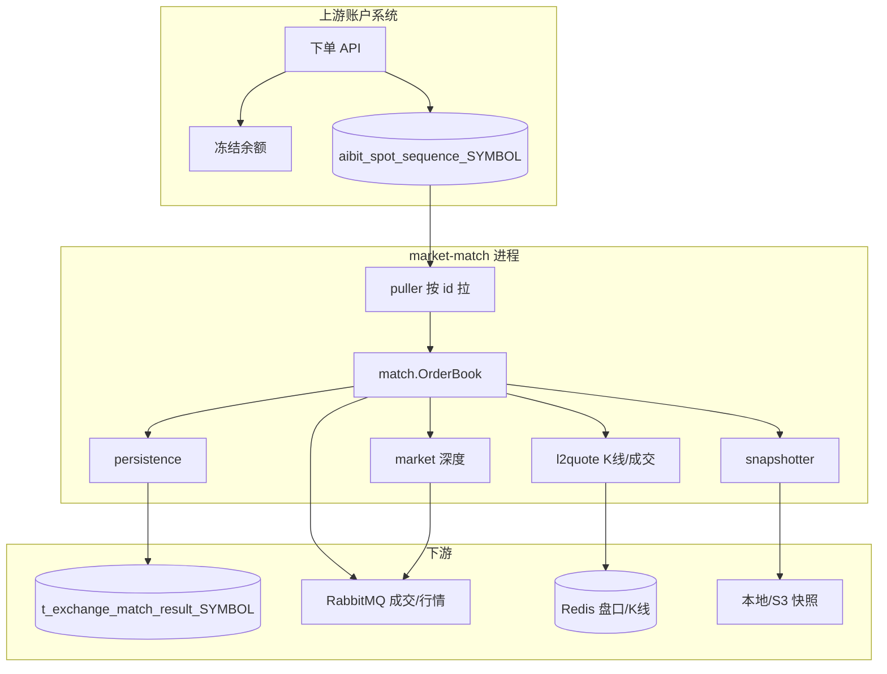
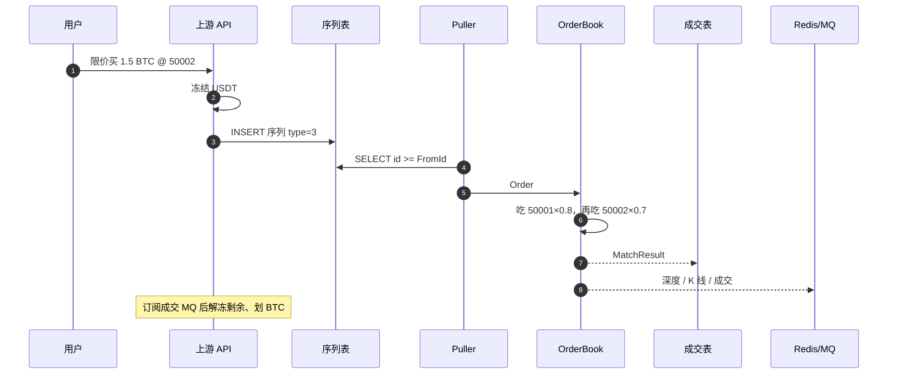

# market-match 撮合引擎项目拆解文档

> 学习目标：从**业务**理解项目。读完应能讲清订单从哪来、怎么进簿、怎么成交、成交价取谁、结果写到哪，以及它和永续 / NFTMarket 的差别。  
> 代码依据：`match/`（撮合核心）、`puller/`（拉单）、`market/` + `l2quote/`（行情）、`persistence/` + `snapshotter/`（落库与恢复）。  
> 注意：这个仓库**没有智能合约**。用户说的「撮合合约」对应的是这里的 **撮合引擎**——中心化交易所那一层「讨价还价」的程序。

---

## 0. 一句话讲清这个项目

market-match 是一个 **现货撮合引擎**：每个交易对一份内存订单簿，按价格优先、时间优先把买卖单对敲，产出成交结果、盘口深度和 K 线。

订单不在链上。上游把已校验的委托写成 MySQL 序列表，引擎按 `id` 顺序拉取、撮合，再把 `MatchResult` 写回库、推 RabbitMQ、刷 Redis 行情。重启时用订单簿快照接着干。

它不是 NFT 市场（订单不写合约），也不是 MetaNode 永续（这里不结算保证金、不算资金费）。永续仓库里的 Relayer 也有一层撮合，但成交后还要调 `Perpetual.trade`；本仓库到成交记录为止。

---

## 1. 项目解决什么问题

把「菜市场讨价还价」做成可恢复、可并发多交易对的程序，必须同时解决：

| 问题 | 本仓库的做法 |
| --- | --- |
| 买卖双方怎么配对 | 每个 symbol 一个 `OrderBook`：买单从高到低、卖单从低到高 |
| 同价谁先成交 | `SeqId` 小的在前（时间优先） |
| 订单从哪来、不能丢、不能乱序 | MySQL `aibit_spot_sequence_{symbol}`，按 id 递增拉 |
| 进程挂了怎么办 | gob 快照订单簿；启动时 Load，再从 `FromId+1` 续拉 |
| 前端要看盘口 / K 线 | `market` 聚合成交档，`l2quote` 写 Redis + MQ |
| 成交记录要对账 | `t_exchange_match_result_{symbol}` + 启动时回放校验 |

和 Pledge / NFTMarket / 永续对照：

| | Pledge | NFTMarket | MetaNode 永续 | **market-match** |
| --- | --- | --- | --- | --- |
| 链上核心 | 资金池状态机 | 订单簿 + Vault | Perpetual + Dealer | **无** |
| 订单在哪 | 无订单 | 链上价格树 | 链下签名 | **MySQL 序列 + 内存簿** |
| 后端角色 | 轮询 view | 扫事件 | Relayer 发 `trade()` | **引擎自己就是撮合** |
| 成交价 | — | 订单价 | Maker | **Maker（对手单价格）** |
| 钱谁管 | PledgePool | Vault | Dealer USDC | **本仓库不管钱**（上游已扣冻结） |

读代码时记住：**引擎只改订单簿和成交结果，不碰余额。** 余额、冻结、手续费入账是上游账户系统的事。

---

## 2. 仓库怎么拆

```
market-match/
├── market-match.go          # 入口：每个 symbol 起一条撮合循环
├── match/                   ★ 订单、订单簿、撮合、成交结果
│   ├── order.go             类型、状态、价格时间比较器
│   ├── order_book.go        Enqueue / Dequeue / Peek
│   └── matcher.go           Match / matchLimit / matchMarket / 撤单
├── puller/                  从序列表拉单，转成 match.Order
├── validate/                启动时用快照回放，核对订单簿
├── persistence/             MatchResult 落 MySQL
├── snapshotter/             订单簿 gob 快照（本地 / S3）
├── market/                  深度档（bids/asks）
├── l2quote/                 K 线、ticker、成交明细 → Redis / MQ
├── rabbitmq/                发布成交与行情（不是下单入口）
├── redis/                   行情缓存
├── scheduler/               快照、深度刷新的 ticker
├── config/ + common/        交易对精度、配置
└── sql/                     序列表、成交表建表语句
```

README 里画了「Client → RabbitMQ → Puller」。**以代码为准：下单入口是 MySQL 序列表，RabbitMQ 用于发出去。**

---

## 3. 整体架构图



每个交易对独立：独立订单簿、独立 puller、独立 matcher goroutine。BTC/USDT 堵了不会卡住 ETH/USDT。

---

## 4. 订单从哪来

打开 `puller/puller.go`。

序列表一行就是一次引擎指令，字段见 `sql/aibit_spot_sequence_eth_usdt.sql`：

- `id`：全局递增，就是 `Order.SeqId`。撮合必须按这个顺序，不能并发乱序。
- `type`：买卖和订单种类打在一个整数里（见下表）
- `amount` / `price` / `circuit_rate` / `user_id` / `stp`

`setOrderType` 把库里的 type 拆成 `BuyOrSell` + `OrderType`：

| type | 含义 |
| --- | --- |
| 0 | 撤单 |
| 1 / 2 | 市价买 / 市价卖 |
| 3 / 4 | 限价买 / 限价卖 |
| 5 / 6 | IOC 买 / 卖（代码里 `Match` 分支被注释，当前不会走） |
| 7 / 8 | FOK 买 / 卖 |
| 9 / 10 | 只挂 Maker（函数在，`Match` 未接入） |
| 13 | 批量撤单（ids 在 Extra） |

精度不对（价格/数量超出交易对 scale）会改成 `SystemCancel`，不进簿。

Puller 循环：`WHERE id >= ? ORDER BY id ASC LIMIT 2000`，推到 `chan *match.Order`。matcher **单线程**从 channel 取，保证同一 symbol 严格串行。

---

## 5. 订单簿：价格优先、时间优先

打开 `match/order.go` 的 `Comparator` 和 `match/order_book.go`。

```
OrderBook
  cache   map[orderId]*Order     撤单 O(1) 查找
  BuySet  TreeSet                买单：价高在前；同价 SeqId 小在前
  SellSet TreeSet                卖单：价低在前；同价 SeqId 小在前
```

树来自 `github.com/emirpasic/gods/sets/treeset`（红黑树）。`Peek(Buy)` / `Peek(Sell)` 取最优一档。`Enqueue` 同时进 cache 和对应 Set；`Dequeue` 两边都删。

贯穿例子（建议抄在纸上）：

```
交易对 BTC/USDT
盘口卖：
  卖单 D  SeqId=10  50001 × 0.8 BTC
  卖单 E  SeqId=11  50002 × 1.2 BTC
盘口买：
  买单 A  SeqId=8   50000 × 0.5 BTC
```

新来限价买 G：50002 × 1.5 BTC。能吃 D 的全部，再吃 E 的 0.7，G 全成，E 剩 0.5 挂着。成交价分别是 **50001、50002**（Maker 价），不是 G 的 50002 一价到底。

`matchAble`：买单价 ≥ 卖单价才能成交。限价买 49999 对卖 50001 → 进 BuySet 等待。

---

## 6. 撮合主循环

打开 `market-match.go` 的 `startMatcher`，再打开 `matcher.go` 的 `GenMatchResult` / `Match`。

每个 symbol 一条 `select` 循环：

1. 来订单 → `book.GenMatchResult(order)`
2. JSON 一份给 persistence，一份给成交 MQ，一份给 l2quote（带买卖一价量）
3. 定时 `Clone()` 订单簿做快照
4. 定时 `BuildAndReportDepth` 刷盘口

`Match` 按类型分发：

```
Market        能吃就吃，吃不完撤掉剩余（不挂簿）
Limit         能吃就吃，吃不完 Enqueue
Cancel        按 orderId 从簿上拿掉
Fok           先预扫描够不够量，不够整笔取消，够了再吃
SystemCancel  精度失败等，直接报撤
BatchCancel   Extra 里一串 orderId
```

限价核心在 `matchLimit`：

```
循环 Peek 对手单
  没有 或 价格配不上 → Enqueue 自己，结束
  配得上 → matchOrder（数量取 min，价取对手单）
            对手单 filled → Dequeue
            自己 filled → 结束，否则继续吃下一档
```

市价有两条腿（`matchOrderMarket`）：

- **市价卖**：`UnfilledAmount` 是币的数量，走 `matchAmountBasedOrder`
- **市价买**：`UnfilledAmount` 是报价币金额（USDT），走 `matchCashAmountBasedOrder`：`可买数量 = 剩余金额 / 对手价`，扣的是金额不是币数

市价还有 `CircuitRate`：相对第一笔成交价偏离过大就 `CircuitCanceled`，防止滑点把盘口扫穿。

成交价一律取 **Maker（`oppoOrder.Price`）**。这点和永续 `Trading._matchOrders`、NFTMarket 吃单价，规则一样：挂单的人决定价，吃单的人决定「现在就要」。

---

## 7. 自成交、FOK、结果怎么长

同一 `userId` 且 `Stp > 0` 时不真正成交，走 STP：

| Stp | 含义 |
| --- | --- |
| CB | 两边都撤 |
| CO | 撤旧单（簿上那张） |
| CN | 撤新单（刚来的 taker） |
| 其它（减量） | 对冲掉重叠数量，剩余继续 |

FOK：`canFilledFokOrder` 顺着对手簿把能配上的量加起来，够 taker 的 `UnfilledAmount` 才真撮，否则 `Canceled`，簿不变。

`MatchResult.items` 里：

- 每吃掉一档 Maker：`role=maker`，带 `filled-amount` 和 Maker 价
- 最后一条 Taker：`role=taker`，带剩余 `unfilled-amount` 和终态（`filled` / `partial-filled` / `submitted` 挂上 / `canceled` …）

限价没成交挂上：Taker 状态是 `submitted`，不是失败。市价没吃到：Taker 变成 `canceled`（市价不挂簿）。

---

## 8. 持久化、快照、校验、行情

**成交落库** `persistence/`：`t_exchange_match_result_{symbol}`，按撮合 id 可回放。

**快照** `snapshotter/`：定时 `book.Clone()`，gob 序列化到 `./sp/{FromId}.{symbol}-snapshot-go`，可上传 S3。启动：

```
lastId = GetLastSnapshotId(symbol)
若 lastId>0 → Load 快照当订单簿
否则空簿 FromId=0
puller 从 lastId+1 开始拉
```

**校验** `validate.ValidateOrderbook`：拿更早一份快照当 base，把中间所有序列单再撮一遍，最后的簿必须和最新快照逐单相等。对不上直接 Fatal。这是确定性撮合的护栏：同样输入必须得到同样订单簿。

**深度** `market/depth.go`：从 BuySet/SellSet 取前 N 档，按交易对 `DepthSteps` 聚合成 `bids`/`asks`。

**L2** `l2quote/`：消费 MatchResult，更新 1m～1mon K 线、24h ticker、逐笔成交，写 Redis，按间隔发 MQ。

引擎不管账户：上游在写序列表之前冻结，看到 MatchResult 再解冻/划转。本仓库崩溃最多影响延迟，不直接丢用户币（币在账户库里）。

---

## 9. 一条买单的时序



三条铁律：

1. **同一交易对必须按 SeqId 串行撮合。** 并行会打乱价格时间优先。
2. **成交价是 Maker 价。** Taker 限价只决定「能不能吃」，不决定成交价。
3. **快照 + 序列 = 可恢复。** 内存簿可以扔，只要快照和后续 id 还在。

---

## 10. 从业务角度怎么读代码

1. `match/order.go`：状态、类型、`Comparator`（1 小时）
2. `match/order_book.go`：Enqueue / Peek / Dequeue（30 分钟）
3. `matcher.go` 的 `matchAble`、`matchLimit`、`matchAmountBasedOrder`（2 小时）
4. `matchMarket` + 市价买的金额算法（1 小时）
5. `matchCancel` / `matchFok` / STP（1 小时）
6. `market-match.go` `startExchange` + `startMatcher` 把周边接上（1 小时）
7. `puller.go` `setOrderType`、`snapshotter` Load/Dump（30 分钟）

测试入口：`match/matcher_test.go`（`matchAble`、限价成交）、`match/order_book_test.go`（入簿出簿）。

---

## 11. 讲解提纲

**1. 这是什么**  
中心化现货撮合引擎。内存订单簿，链下完成，不管保证金。

**2. 订单怎么排**  
买高卖低，同价先到先得。红黑树 + orderId cache。

**3. 成交价**  
对手单（Maker）价格。市价买用金额除以该价格得到可买数量。

**4. 限价 vs 市价 vs FOK**  
限价剩余挂上；市价剩余撤销；FOK 要么全成要么不动簿。

**5. 为什么能重启**  
快照恢复簿，序列表从 FromId+1 续跑；启动回放校验确定性。

**6. 和永续 / NFT 差在哪**  
永续撮合同样链下，但还要上链改 paper/credit；NFTMarket 订单在链上红黑树。这里没有链。

---

## 12. 读完后的自检

1. 买单 50002、卖单 50001，成交价是哪个？
2. 限价没吃完去哪？市价没吃完去哪？
3. 同价两张买单谁先成交？
4. 市价买的 `UnfilledAmount` 是 BTC 还是 USDT？
5. 订单从 RabbitMQ 来还是从 MySQL 来？（以代码为准）
6. `validOrderSender` 在这仓库存在吗？
7. 引擎重启，未成交挂单怎么回来？
8. 自己的买单吃自己的卖单，默认会成交吗？
9. FOK 预扫描失败，订单簿变了吗？
10. 这套系统和 NFTMarket 链上订单簿、永续 Relayer，本质差别各是什么？
